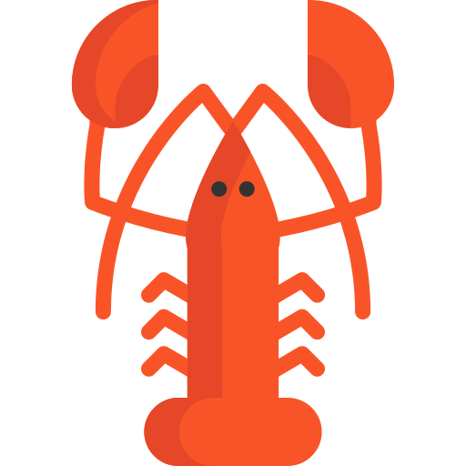

Welcome to Lobster!
===================

Lobster is a statically typed programming language with a Python-esque
syntax that combines the advantages of an expressive type system and
compile-time memory management with a very lightweight, friendly and terse
syntax, by doing most of the heavy lifting for you. It is competitive in
[speed](RESULTS.html) with the fastest languages.

<a href="getting_started.html" class="button">Get started</a> <a href="language_reference.html" class="button secondary">Language reference</a>

The homepage has more on [the "why" of Lobster](http://strlen.com/lobster/).
Chat on [Discord](https://discord.gg/szJPYdX) or
[Gitter](https://gitter.im/lobster_programming_language/community).

This document is the starting point for all the Lobster documentation.

### Using the compiler

A quick [getting started](getting_started.html) guide.

More detailed: using Lobster from the [command line](command_line_usage.html), or setting up
editors such as [VSCode](vscode_ide.html), [Sublime Text](sublime_ide.html),
[Notepad++](notepadpp_ide.html) or [vim](https://github.com/jcorbin/vim-lobster) as IDE.
[Lite-XL](https://github.com/lite-xl/lite-xl/) has a syntax highlighting
[plugin](https://github.com/lite-xl/lite-xl-plugins/blob/master/plugins/language_lobster.lua).

> Right now VSCode is the only one with a lsp.

### Learning the language

If you already know how to program in at least one C-style language
(C/C++/C\#/Java/JavaScript etc), then a way to get a quick idea of where
Lobster is different is by looking at the [C-style language Cheat
Sheet](C_style%20language%20Cheat%20Sheet%20for%20Lobster.html).

Useful for reference: [all builtin functions](builtin_functions_reference.html)
(this part of the documentation is auto-generated by the compiler).

Tutorials: How to [build a 2D shooter](shooter_tutorial.html) step by step in
Lobster.

To learn the language more in-depth: The [language
reference](language_reference.html). Check out the [style
guide](style_guide.html) before you write lots of code :) Read about the [type
system](type_checker.html) or [memory management](memory_management.html).
The [language spec](language_spec.html) has more detail on the exact behavior
of current language features.

### Building Lobster

Read about the [implementation](implementation.html) to be able to compile,
extend or use Lobster for your own C++ projects.

### Using the engine

Lobster comes with [built-in functionality for drawing](engine.html)
and many other things.

A small example
---------------

~~~~ {.lobster}
import vec
import color
import gl

fatal(gl.window("sierpinski", 512, 512))

let directions = [ float2_0, float2_x, float2_y ]
let poly = gl.new_poly(directions)

def sierpinski(depth) -> void:
    if depth:
        gl.scale 0.5:
            for(directions) d:
                gl.translate d:
                    sierpinski(depth - 1)
    else:
        gl.render_mesh(poly)

while gl.frame():
    if gl.button("escape") == 1: return
    gl.clear(color_black)
    gl.scale(float(gl.window_size()))
    sierpinski(7)
~~~~

[samples/sierpinski.lobster](https://github.com/aardappel/lobster/blob/master/samples/sierpinski.lobster)
draws a Sierpinski triangle.

About Lobster
-------------

Lobster was designed and implemented by Wouter van Oortmerssen
([strlen.com](https://strlen.com), aardappel\ at\ gmail\ dot\ com).

It has been released under the Apache v2 open source licence.

Read about the [design philosophy, history and future](philosophy.html).

[GitHub](https://github.com/aardappel/lobster)
[Discord](https://discord.gg/szJPYdX)
[Gitter](https://gitter.im/lobster_programming_language/community)
[Facebook](https://www.facebook.com/lobsterprogramminglanguage)
[Twitter \@wvo](https://twitter.com/wvo)

